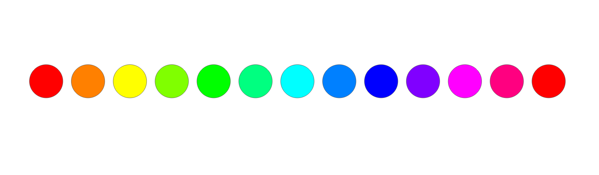
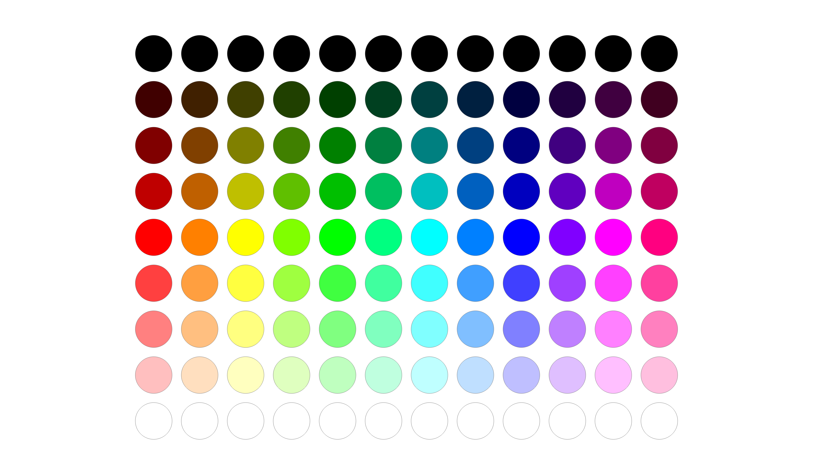
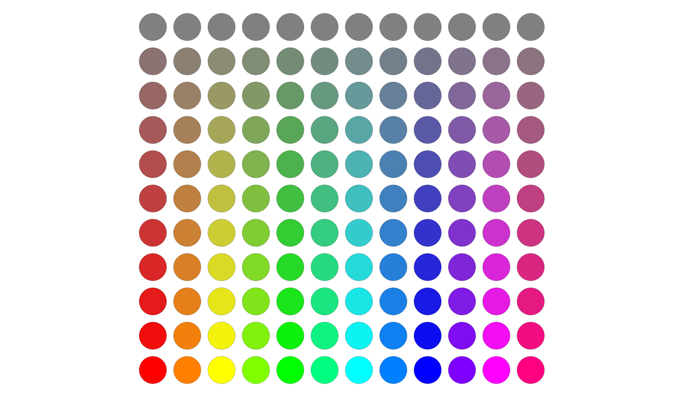
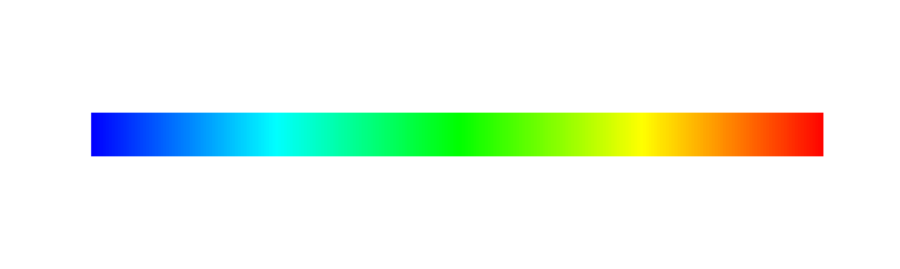

# Colors and Color Maps

In COMPAS colors are defined in RGB color space, with components in the range of 0-1.

## Basic Usage

## Color Spaces

## Color Information

## The RGB Color Circle

The color class ([`compas.colors.Color`][compas.colors.Color]) provides constructor methods
for the primary, secondary, and tertiary colors of the RGB color wheel or color circle.

### Primary Colors

```pycon
>>> Color.red()
Color(1.0, 0.0, 0.0, 1.0)
>>> Color.green()
Color(0.0, 1.0, 0.0, 1.0)
>>> Color.blue()
Color(0.0, 0.0, 1.0, 1.0)
```

### Secondary Colors

```pycon
>>> Color.yellow()
Color(1.0, 1.0, 0.0, 1.0)
>>> Color.cyan()
Color(0.0, 1.0, 1.0, 1.0)
>>> Color.magenta()
Color(1.0, 0.0, 1.0, 1.0)
```

### Tertiary Colors

```pycon
>>> Color.orange()
Color(1.0, 0.5, 0.0, 1.0)
>>> Color.lime()
Color(0.5, 1.0, 0.0, 1.0)
>>> Color.mint()
Color(0.0, 1.0, 0.5, 1.0)
>>> Color.azure()
Color(0.0, 0.5, 1.0, 1.0)
>>> Color.violet()
Color(0.5, 0.0, 1.0, 1.0)
>>> Color.pink()
Color(1.0, 0.0, 0.5, 1.0)
```


## Lighter and Darker Colors

The color class ([`compas.colors.Color`][compas.colors.Color]) provides methods to generate lighter and darker variations of a given color.
The methods can be used to modify the colors in-place ([`compas.colors.Color.lighten`][compas.colors.Color.lighten] and [`compas.colors.Color.darken`][compas.colors.Color.darken]),
or to generate new colors ([`compas.colors.Color.lightened`][compas.colors.Color.lightened] and [`compas.colors.Color.darkened`][compas.colors.Color.darkened]).

```pycon
>>> red = Color.red()
>>> red.lighten(50)
None
>>> red.darken(50)
None
>>> red
Color(1.0, 0.0, 0.0, 1.0)
```

```pycon
>>> red = Color.red()
>>> red.lightened(50)
Color(1.0, 0.5, 0.5, 1.0)
>>> red.darkened(50)
Color(0.5, 0.0, 0.0, 1.0)
```


## Saturation

Similar to generating lighter and darker colors, the color class provides methods for saturating or desaturating colors
([`compas.colors.Color.saturate`][compas.colors.Color.saturate] and [`compas.colors.Color.desaturate`][compas.colors.Color.desaturate], and [`compas.colors.Color.saturated`][compas.colors.Color.saturated] and [`compas.colors.Color.desaturated`][compas.colors.Color.desaturated]).


## Color Maps

Using [`compas.colors.ColorMap`][compas.colors.ColorMap], color maps can be constructed from various color inputs.

- [`compas.colors.ColorMap.from_rgb`][compas.colors.ColorMap.from_rgb]
- [`compas.colors.ColorMap.from_color`][compas.colors.ColorMap.from_color]
- [`compas.colors.ColorMap.from_two_colors`][compas.colors.ColorMap.from_two_colors]
- [`compas.colors.ColorMap.from_three_colors`][compas.colors.ColorMap.from_three_colors]

Maps based on named scientific color palettes designed by Fabio Crameri (<https://www.fabiocrameri.ch/colourmaps/>)
and some of the `matplotlib` color palettes are also available.

- [`compas.colors.ColorMap.from_palette`][compas.colors.ColorMap.from_palette]
- [`compas.colors.ColorMap.from_mpl`][compas.colors.ColorMap.from_mpl]

There is currently no predefined function for color map examples.
However, using the following template we can compare various examples.

```pycon
>>> from compas.geometry import Point, Polygon
>>> from compas.itertools import linspace, pairwise
>>> from compas.datastructures import Mesh
>>> from compas.colors import Color, ColorMap
>>> from compas_viewer import Viewer
```

```pycon
>>> n = 1000
>>> t = 0.3
```

```pycon
>>> up = []
>>> down = []
>>> for i in linspace(0, 10, n):
...    point = Point(i, 0, 0)
...    up.append(point + [0, t, 0])
...    down.append(point - [0, t, 0])
```

```pycon
>>> polygons = []
>>> for (d, c), (a, b) in zip(pairwise(up), pairwise(down)):
...    polygons.append(Polygon([a, b, c, d]))
```

```pycon
>>> mesh = Mesh.from_polygons(polygons)
```

```pycon
>>> cmap = ...  # define color map here
>>> facecolor = {i: cmap(i, minval=0, maxval=n - 1) for i in range(n)}
```

```pycon
>>> viewer = Viewer(show_grid = False)
>>> viewer.scene.add(mesh, facecolor=facecolor, show_lines=False)
>>> viewer.show()
```

### From Palette

```pycon
>>> cmap = ColorMap.from_mpl('viridis')
```


### From RGB

```pycon
>>> cmap = ColorMap.from_rgb()
```


### From One Color

```pycon
>>> cmap = ColorMap.from_color(Color.red())
>>> cmap = ColorMap.from_color(Color.red(), rangetype='light')
>>> cmap = ColorMap.from_color(Color.red(), rangetype='dark')
```


### From Two Colors

```
>>> cmap = ColorMap.from_two_colors(Color.from_hex('#0092D2'), Color.pink())
>>> cmap = ColorMap.from_two_colors(Color.from_hex('#0092D2'), Color.pink(), diverging=True)
```


### From Three Colors

```
>>> cmap = ColorMap.from_three_colors(Color.red(), Color.green(), Color.blue())
```


